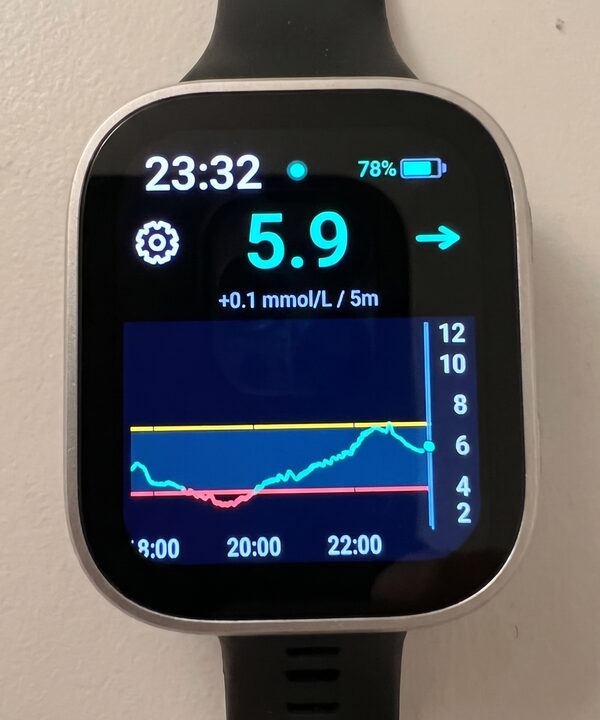
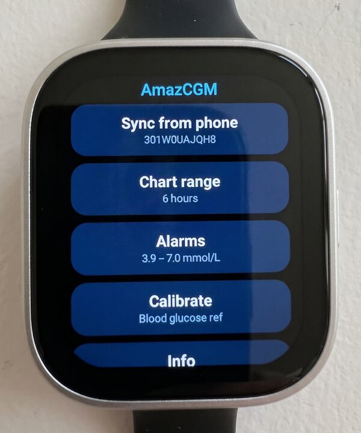
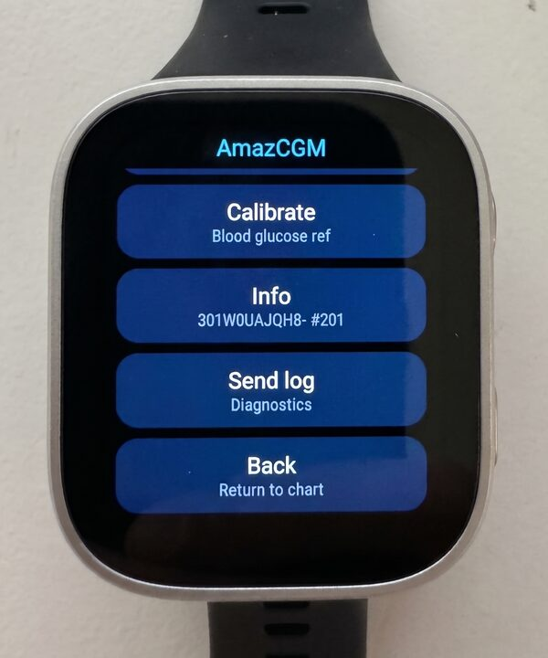
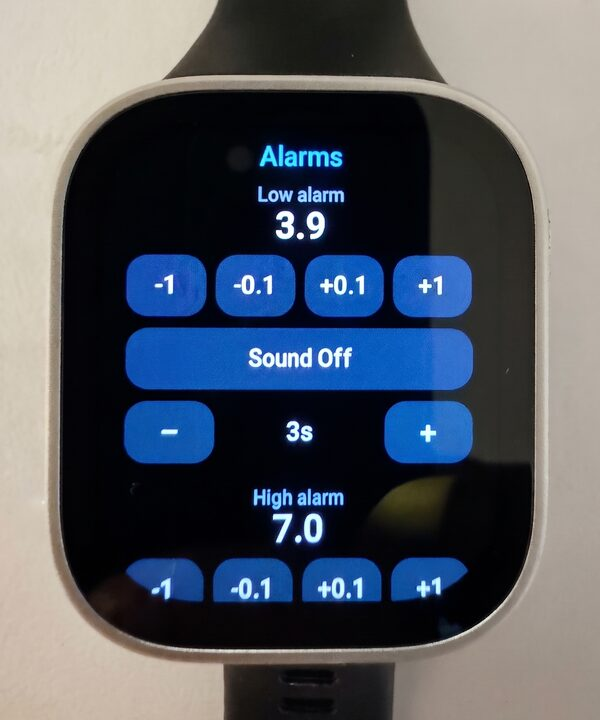
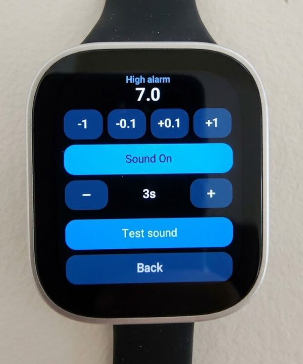
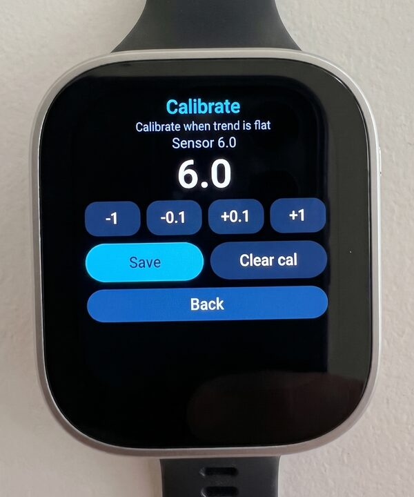

# AmazCGM

[](https://github.com/vstoianov/amazcgm/releases/latest)
[](https://github.com/vstoianov/amazcgm/releases)

**CGM glucose readings directly on your Amazfit watch, over Bluetooth, with no phone in the loop.**

**Current supported sensors**: Libre 2+(EU)

For Libre 2+(EU) the watch connects to the sensor itself, unlocks the Bluetooth stream and shows a new reading every minute. Your phone can be off, at home or out of battery. You need a phone only once per sensor, to scan it with NFC.

> [!WARNING]
> **AmazCGM is not a medical device.** It is an independent hobby project. It is not made, approved or supported by Abbott, Zepp Health or Amazfit.
> Readings can be late, wrong or missing, and alarms can fail. **Do not make treatment decisions from this watch.** Confirm with your official reader, the official app or a finger-stick.
> You use it entirely at your own risk.

<p align="center">
  
</p>

<!-- TODO: add a link to a short demo video -->

## Features

- Live glucose in mmol/L with trend arrow and change since the last reading
- Chart with 3, 6 and 12 hour windows; tap to step back through up to 72 hours of history
- Low and high alarms with vibration and sound, also when the app is in the background
- Optional calibration against finger-stick values
- Automatic reconnect when the sensor goes out of range, with a background service that reopens the app if the watch closed it
- Debug log you can copy from the Zepp app settings, for bug reports

## Screenshots

<table>
  <tr>
    <td align="center"><a href="docs/images/main.jpg"></a></td>
    <td align="center"><a href="docs/images/menu.jpg"></a></td>
    <td align="center"><a href="docs/images/menu-2.jpg"></a></td>
  </tr>
  <tr>
    <td align="center">Main screen</td>
    <td align="center">Menu</td>
    <td align="center">Menu, page 2: info and log</td>
  </tr>
  <tr>
    <td align="center"><a href="docs/images/alarms.jpg"></a></td>
    <td align="center"><a href="docs/images/high-alarm.jpg"></a></td>
    <td align="center"><a href="docs/images/calibrate.jpg"></a></td>
  </tr>
  <tr>
    <td align="center">Alarms</td>
    <td align="center">High alarm settings</td>
    <td align="center">Calibration</td>
  </tr>
</table>

## Requirements

| Watch | Screen | Status |
|---|---|---|
| Amazfit Bip Max | 432×514 | Tested daily |
| Amazfit T-Rex 3 | 480×480 round | Experimental: layout checked, sensor link not yet tested |
| Amazfit T-Rex 3 Pro (48 mm / 44 mm) | 480×480 / 466×466 round | Experimental |
| Amazfit Balance 2 / Balance 2 XT | 480×480 round | Experimental |
| Amazfit Active Max | 480×480 round | Experimental |

One release file covers all of these watches. The Zepp app installs the right version for your watch.

You also need a **FreeStyle Libre 2 Plus sensor, EU version**, and an **Android phone with NFC** once per sensor for setup.

Other Libre models (Libre 2 US, Libre 3) are not supported. If you run AmazCGM on one of the experimental watches, please report whether the sensor connects. Open an issue either way.

## How it works

1. **Once per sensor:** scan the sensor with the [Libre2 Key](https://github.com/vstoianov/cgmnfc) Android app. It reads the sensor over NFC and shows its serial number and patch info.
2. In Libre2 Key tap **Share JSON** and send it to the phone with the Zepp app. In Zepp open **Profile → your watch → App settings → AmazCGM** and tap **Paste JSON**.
3. Open AmazCGM on the watch and tap **Sync from phone** in its menu. The watch shows the serial and patch it got.
4. **From then on, the watch works alone.** It finds the sensor's Bluetooth advert, logs in, sends the unlock command and decrypts each glucose packet on the watch.

**Direct Bluetooth.** After a scan, Libre2 Key is also visible to the watch over Bluetooth for 10 minutes, and **Sync from phone** tries that first, without the Zepp app. While visible, Libre2 Key names the phone `AMZCGM` in Bluetooth, the same way the sensor advertises `ABBOTT<serial>`; the phone's normal name comes back afterwards. During the attempt the watch pauses its sensor link for a few seconds. If it reports "Not found", **Nearby devices** in the AmazCGM menu lists what the scan saw, and the sync falls back to the scan pasted in Zepp.

Zepp OS gives watch apps no network access, so there is no Wi‑Fi transfer.

The Libre 2 unlock and decryption maths is ported from [DiaBLE](https://github.com/gui-dos/DiaBLE) and [LibreTools](https://github.com/ivalkou/LibreTools). See [NOTICE](NOTICE) for credits.

## Install

### From a release (recommended)

You need the Zepp app on your phone, with your watch paired to it, and a second screen (a computer or another phone) to show the QR code.

1. On the second screen, open the **[latest release](https://github.com/vstoianov/amazcgm/releases/latest)**.
2. On your phone, turn on Zepp developer mode: in the Zepp app go to **Profile → Settings → About** and tap the Zepp logo 7 times.
3. In the Zepp app go to **Profile → your watch → Developer mode → Scan** and scan the QR code for your watch on the release page. There is one for the Bip Max, one for the T-Rex 3 Pro 44 mm, and one for the other round watches.
4. Keep the watch close to the phone until the installation finishes. AmazCGM then appears in the watch's app list.

**Updating:** repeat the same steps with the newer release.

**Advanced:** each release also has the `.zab` file and a `.sha256` checksum. You can check the file with `sha256sum -c AmazCGM-x.y.z.zab.sha256` and install it with the Zeus CLI.

### Build from source

You need Node.js 18 or newer and the [Zeus CLI](https://docs.zepp.com/docs/guides/tools/cli/).

```sh
npm install
npx zeus build      # creates dist/*.zab
npx zeus preview    # builds and shows a QR code to install through the Zepp app (developer mode)
npm test            # unlock and calibration unit tests
```

Maintainers: see [RELEASING.md](RELEASING.md) for how to publish a release.

## Battery and known limits

<!-- TODO: add your measured battery life, for example "about N days with a reading every minute" -->
- Battery of the **Amazfit Bip Max** last about 8-9 days with a reading every minute.
- Bluetooth on the Bip Max sometimes gets stuck after many hours. AmazCGM detects this, rebuilds the connection and, if that fails, tells you to restart the watch.
- When the sensor ends (after 15 days) or is replaced, scan the new one with Libre2 Key, paste the new JSON in Zepp and tap **Sync from phone** on the watch.
- Readings stop while the watch is out of Bluetooth range of the sensor, which is usually a few metres.

## Reporting a problem

Open an [issue](https://github.com/vstoianov/amazcgm/issues) and include:

- what happened and at what time,
- the app version, for example `v1.8.3` (the release you installed, also shown in the Zepp app under the watch's installed apps),
- the debug log: in the Zepp app go to AmazCGM settings, tap **Copy log** and paste it into the issue.

The log contains your sensor's Bluetooth address. Remove it if you prefer.

## Support the project

AmazCGM is free and always will be. If it helps you, you can support further development:

- [GitHub Sponsors](https://github.com/sponsors/vstoianov)
- [Ko-fi](https://ko-fi.com/vstoianov) 

## License

AmazCGM is licensed under the [GNU General Public License v3.0 or later](LICENSE). You may use, study, change and share it. If you distribute a changed version, it must also be released under the GPL with its source code.

Bundled third-party code keeps its own MIT license. See [NOTICE](NOTICE).

FreeStyle Libre is a trademark of Abbott. Amazfit and Zepp are trademarks of Zepp Health. They are used here only to describe compatibility.
